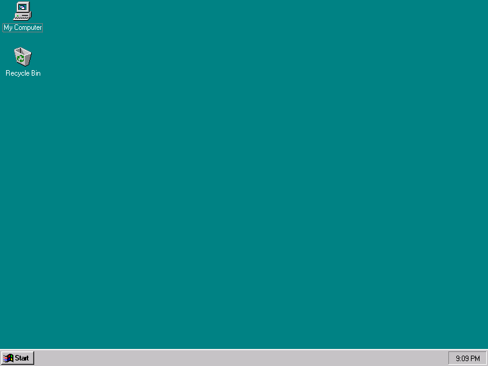
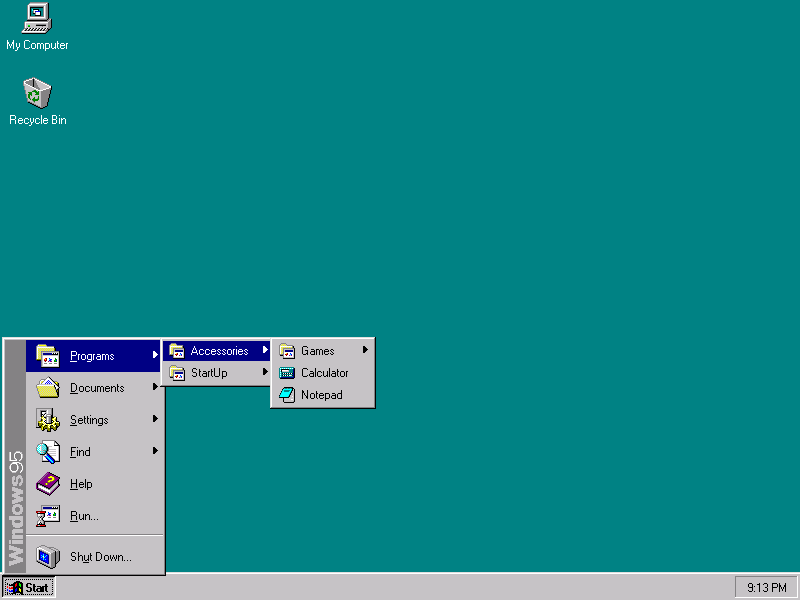
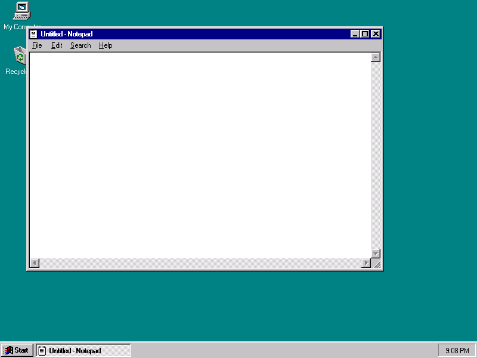
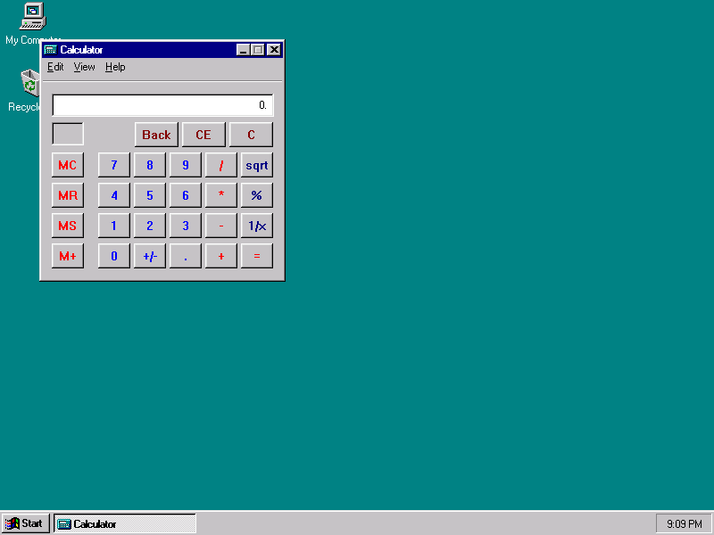
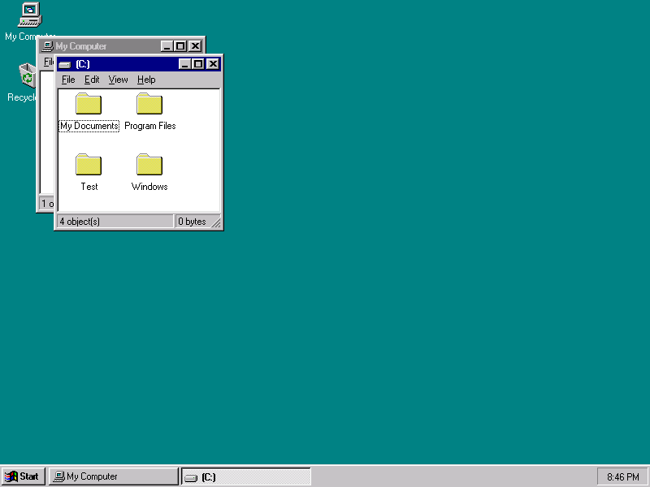

# win95-recomp

Windows 95's own userland, statically recompiled with
[pcrecomp](https://github.com/sp00nznet/pcrecomp) and run on a modern Windows
host, with no emulator. Sibling of win98-recomp, one version earlier: the same
architecture (lifted kernel32 on pcrecomp's VxD answers, then KRNL386/USER/GDI
in Win16 identity mode), with Windows 95's differences behind a build check in
pcrecomp.

**This repository contains no Windows code or data.** Everything from your
copy (extracted CAB files, catalogs, lifted C) goes into the gitignored
`work/` and `src/gen/`.



| | |
|---|---|
|  |  |
| Explorer's Start menu | Start > Programs > Accessories > Notepad |
|  |  |
| Start > Run > Calculator | My Computer > C: (the sandbox root) |
|  |  |
| Solitaire (Win16) from the Start menu | Windows move, minimize and close |

Screenshots show the guest's own screen, drawn by Win95's USER/GDI through
pcrecomp's display driver stand-in.

## Status

**Milestone 2 done.** Win95 OSR2 boots its own Explorer desktop here, with no emulator and no
original code executed: the Start menu and its shortcuts, Run, Notepad, Calculator, Solitaire and
Minesweeper work, My Computer opens C: (work/root), and windows move, minimize, restore and close.
Ten gates (`tools/check_{m1,calc,explorer,run,startprog,sol,mycomp,notepad,winmine,close}.sh`)
pass. Safety model as win98-recomp: guest memory never executable, registry boxed, files in
work/root, no host shell, muted. Known gaps and how to debug are at the end of docs/survey.md.

| Stage | What | State |
|---|---|---|
| 1 | Survey: Win95 vs Win98 SE kernel32, boot, VxD services (`docs/survey.md`) | done |
| 2 | milestone 1: a console program on Win95's own kernel32 | **done**: `xcopy32 /?` prints exactly its string resources, `/S /I` copies a tree byte-identically, `/P` honours y/n (`tools/check_m1.sh`) |
| 3 | milestone 2: KRNL386/USER/GDI boot, calc, Explorer | **done**: calc (12+3=15), Explorer as the shell with Start, Run and Programs shortcuts, My Computer by double-click, Notepad, Solitaire, Minesweeper, window close/move/minimize |

Tested with Windows 95 OSR2 (4.00.1111), English.

## Getting Started

You need **your own copy of Windows 95 OSR2**: its CD image, an `.iso`.
Nothing from Windows is in this repository or downloaded for you; everything
is extracted and built on your machine from your CD.

1. Download this repository (the green **Code** button, then **Download ZIP**)
   and unzip it, or `git clone` it, somewhere with 2 GB free (no `&` in the path).
2. Put your Windows 95 OSR2 `.iso` in that folder (or give it with
   `Setup.cmd -Iso <path>`).
3. Double-click **`Setup.cmd`**. From Git Bash, `./setup.sh` does the same
   (`--iso FILE`, `--yes`, `--force`); it is Windows only, as the build is MSVC x86.
4. Start Windows 95 with **`Windows 95 (recomp).cmd`** in that folder.

The script asks before installing anything it needs (Python and its packages,
7-Zip, Visual Studio 2022's C++ Build Tools, CMake, Ninja, and pcrecomp beside
this folder, or where `PCRECOMP` points), then extracts the CD and its CABs,
rebases, seeds, lifts and builds, and fills the guest's registry box and C:\
(a first boot on a hidden desktop, muted). The first run took 8.5 minutes from a
clean clone here (a 12-thread machine; slower ones take longer, mostly the
compile) and leaves about 1.3 GB: work\ 280 MB, src\gen 66 MB, build\ 930 MB.
A rerun skips every finished step in seconds (`-Force` redoes them). Everything it
does goes to `setup.log`.

## Building by hand

Visual Studio 2022 (x86 tools), CMake, Ninja, Python 3 with `capstone` and
`pefile`, 7-Zip, and pcrecomp at `../pcrecomp` (or `PCRECOMP`; its main branch has the
Windows 95 runtime).

```
7z x -owork\cd <your Win95 OSR2 .iso> win95\*
for %c in (work\cd\win95\win95_*.cab) do 7z e -y -owork\sys %c
7z e -y -aos -owork\sys work\cd\win95\PRECOPY1.CAB
7z e -y -aos -owork\sys work\cd\win95\MINI.CAB
py -3 tools\seeds.py
py -3 tools\lift.py xcopy work\sys\xcopy32.exe work\sys\kernel32.dll
build.cmd --target xcopy
sh tools/run_xcopy.sh -- /?
sh tools/check_m1.sh
```

Milestone 2 so far (Win16 identity mode, after the steps above):

```
py -3 tools\w16_seeds.py work\sys > work\seeds\w16.json
set NE_IDENTITY_SEL=1
py -3 ..\pcrecomp\tools\ne\ne_link.py --work work\w16 --seeds work\seeds\w16.json --shims ..\pcrecomp\runtime\win16\identity work\sys\KRNL386.EXE work\sys\GDI.EXE work\sys\USER.EXE work\sys\DDEML.DLL work\sys\MSGSRV32.EXE work\sys\shell.new work\sys\commdlg.new work\sys\kommctrl.dll work\sys\winmine.exe work\sys\sol.exe work\sys\cards.dll
py -3 ..\pcrecomp\tools\pe\rebase.py work\sys work\rebased calc.exe=0x01000000 notepad.exe=0x01100000 explorer.exe=0x01400000   (then rename them calc_1000.exe, notepad_1100.exe, explorer_1400.exe)
py -3 tools\lift.py w16test work\sys\xcopy32.exe work\sys\kernel32.dll work\sys\gdi32.dll work\sys\advapi32.dll work\sys\user32.dll work\sys\mpr.dll work\sys\mprexe.exe work\sys\mprserv.dll work\sys\mspwl32.dll work\rebased\calc_1000.exe work\sys\comctl32.dll work\sys\shell32.dll work\rebased\explorer_1400.exe work\rebased\notepad_1100.exe work\sys\comdlg32.dll work\sys\linkinfo.dll
build.cmd
set W16_LIBMAIN=KERNEL & set W16_WINDOW=1 & set W16_SHELL=explorer.exe & build\w16test.exe --mute     (W16_TRACE=1 for the 16-bit side)
```

Extract the main set (`win95_*.cab`) first, then PRECOPY1.CAB and MINI.CAB without overwriting (`7z e -aos`): those hold Setup's
Windows 3.1-based KRNL386/USER/GDI under the same names (docs/survey.md), and are
the only source of kommctrl.dll and the INFs reginst reads.

`VXD=1 sh tools/run_xcopy.sh -- /?` traces every VxD service. An unknown
service stops the run with its id. The guest's C:\ is `work/root`; its
registry is boxed under `HKCU\Software\pcrecomp\w95\<app>` (pcrecomp
regbox32). Runs are muted.

Tools for the port: `tools/k32map.py` finds Win95's counterpart of a Win98 SE
kernel32 address, `tools/k32svc.py` pairs the two kernel32s' VxD service ids
(`--why ID` shows who calls one).

## License

MIT (LICENSE). Windows 95 is Microsoft's; bring your own copy.
