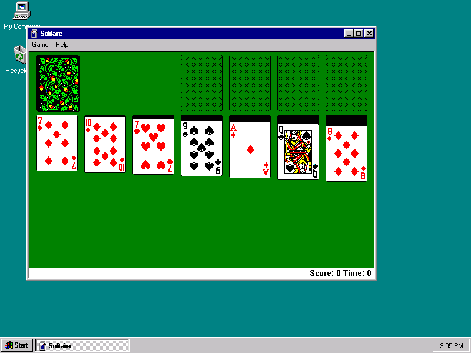
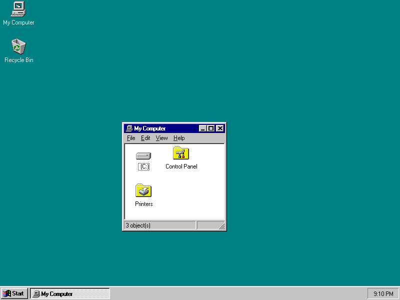

# win95-recomp

Windows 95's own userland, statically recompiled with
[pcrecomp](https://github.com/sp00nznet/pcrecomp) and run on a modern Windows
host, with no emulator. Sibling of win98-recomp, one version earlier: the same
architecture (lifted kernel32 on pcrecomp's VxD answers, then KRNL386/USER/GDI
in Win16 identity mode), with Windows 95's differences behind a build check in
pcrecomp.

**This repository contains no Windows code or data.** Everything from your
copy (extracted CAB files, catalogs, lifted C) goes into the gitignored
`work/` and `src/gen/`.


| | |
|---|---|
|  |  |
| Explorer's Start menu | Start > Programs > Accessories > Notepad |
|  |  |
| Start > Run > Calculator | My Computer > C: (the sandbox root) |
|  |  |
| Solitaire (Win16) from the Start menu | Windows move, minimize and close |

Screenshots show the guest's own screen, drawn by Win95's USER/GDI through
pcrecomp's display driver stand-in.

## Status

**Milestone 2 done.** Win95 OSR2 boots its own Explorer desktop here, with no emulator and no
original code executed: the Start menu and its shortcuts, Run, Notepad, Calculator, Solitaire and
Minesweeper work, My Computer opens C: (work/root), and windows move, minimize, restore and close.
Ten gates (`tools/check_{m1,calc,explorer,run,startprog,sol,mycomp,notepad,winmine,close}.sh`)
pass. Safety model as win98-recomp: guest memory never executable, registry boxed, files in
work/root, no host shell, muted. Known gaps and how to debug are at the end of docs/survey.md.

| Stage | What | State |
|---|---|---|
| 1 | Survey: Win95 vs Win98 SE kernel32, boot, VxD services (`docs/survey.md`) | done |
| 2 | milestone 1: a console program on Win95's own kernel32 | **done**: `xcopy32 /?` prints exactly its string resources, `/S /I` copies a tree byte-identically, `/P` honours y/n (`tools/check_m1.sh`) |
| 3 | milestone 2: KRNL386/USER/GDI boot, calc, Explorer | **done**: calc (12+3=15), Explorer as the shell with Start, Run and Programs shortcuts, My Computer by double-click, Notepad, Solitaire, Minesweeper, window close/move/minimize |

Tested with Windows 95 OSR2 (4.00.1111), English.

## Setup

Double-click `Setup.cmd` (or `./setup.sh` from Git Bash) with your Windows 95 OSR2 .iso in
this folder: it extracts, lifts, builds and fills the boxed registry, then leaves
`Windows 95 (recomp).cmd`, which starts Explorer.

## Building by hand

Visual Studio 2022 (x86 tools), CMake, Ninja, Python 3 with `capstone` and
`pefile`, 7-Zip, and pcrecomp at `../pcrecomp` (or `PCRECOMP`) with the
Windows 95 runtime (branch `w95`).

```
7z x -owork\cd <your Win95 OSR2 .iso> win95\*
for %c in (work\cd\win95\win95_*.cab) do 7z e -y -owork\sys %c
py -3 tools\seeds.py
py -3 tools\lift.py xcopy work\sys\xcopy32.exe work\sys\kernel32.dll
build.cmd --target xcopy
sh tools/run_xcopy.sh -- /?
sh tools/check_m1.sh
```

Milestone 2 so far (Win16 identity mode, after the steps above):

```
py -3 tools\w16_seeds.py work\sys > work\seeds\w16.json
set NE_IDENTITY_SEL=1
py -3 ..\pcrecomp\tools\ne\ne_link.py --work work\w16 --seeds work\seeds\w16.json --shims ..\pcrecomp\runtime\win16\identity work\sys\KRNL386.EXE work\sys\GDI.EXE work\sys\USER.EXE work\sys\DDEML.DLL work\sys\MSGSRV32.EXE work\sys\shell.new work\sys\commdlg.new work\sys\kommctrl.dll work\sys\winmine.exe work\sys\sol.exe work\sys\cards.dll
py -3 ..\pcrecomp\tools\pe\rebase.py work\sys work\rebased calc.exe=0x01000000 notepad.exe=0x01100000 explorer.exe=0x01400000   (then rename them calc_1000.exe, notepad_1100.exe, explorer_1400.exe)
py -3 tools\lift.py w16test work\sys\xcopy32.exe work\sys\kernel32.dll work\sys\gdi32.dll work\sys\advapi32.dll work\sys\user32.dll work\sys\mpr.dll work\sys\mprexe.exe work\sys\mprserv.dll work\sys\mspwl32.dll work\rebased\calc_1000.exe work\sys\comctl32.dll work\sys\shell32.dll work\rebased\explorer_1400.exe work\rebased\notepad_1100.exe work\sys\comdlg32.dll work\sys\linkinfo.dll
build.cmd
set W16_LIBMAIN=KERNEL & set W16_WINDOW=1 & set W16_SHELL=explorer.exe & build\w16test.exe --mute     (W16_TRACE=1 for the 16-bit side)
```

Extract only the main set (`win95_*.cab`): MINI.CAB and PRECOPY1/2.CAB hold Setup's
Windows 3.1-based KRNL386/USER/GDI under the same names (docs/survey.md).

`VXD=1 sh tools/run_xcopy.sh -- /?` traces every VxD service. An unknown
service stops the run with its id. The guest's C:\ is `work/root`; its
registry is boxed under `HKCU\Software\pcrecomp\w95\<app>` (pcrecomp
regbox32). Runs are muted.

Tools for the port: `tools/k32map.py` finds Win95's counterpart of a Win98 SE
kernel32 address, `tools/k32svc.py` pairs the two kernel32s' VxD service ids
(`--why ID` shows who calls one).

## License

MIT (LICENSE). Windows 95 is Microsoft's; bring your own copy.
